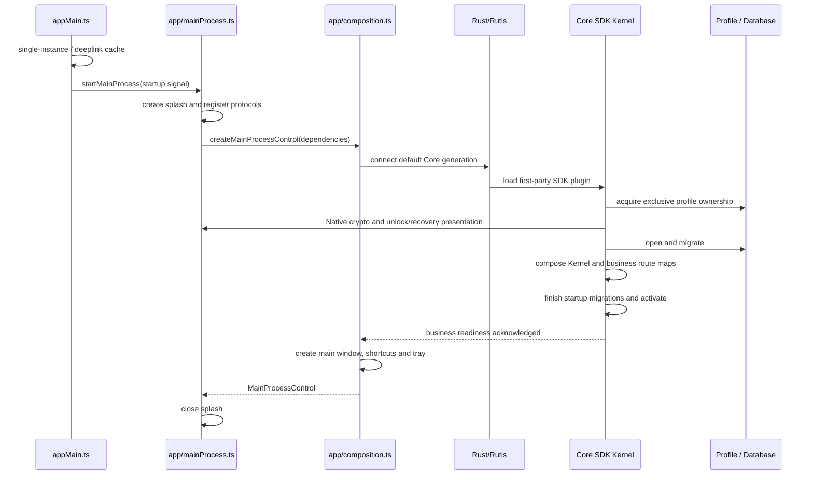
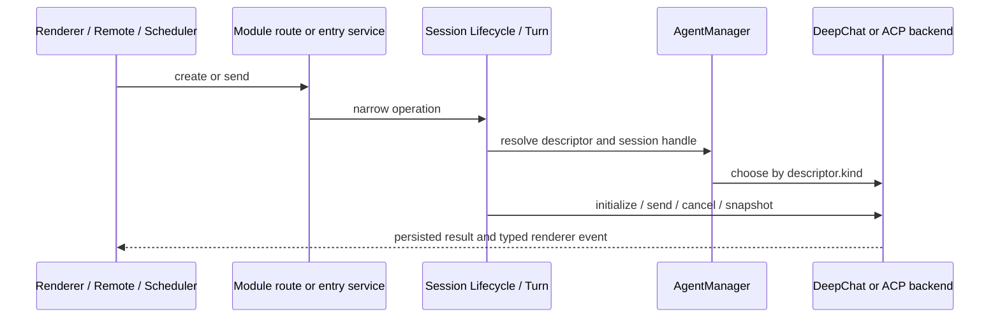
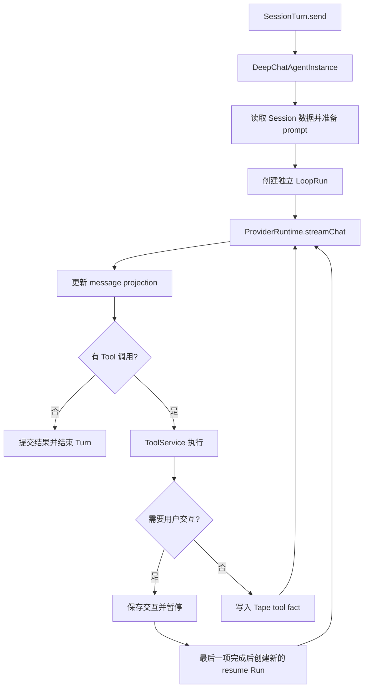
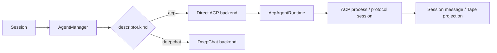
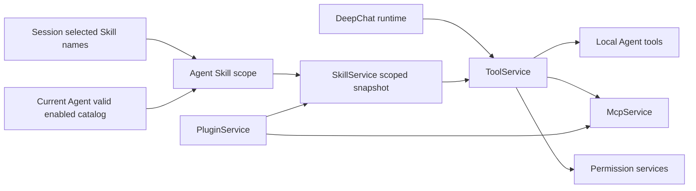
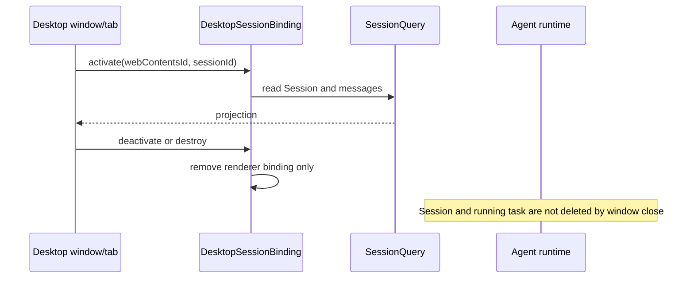
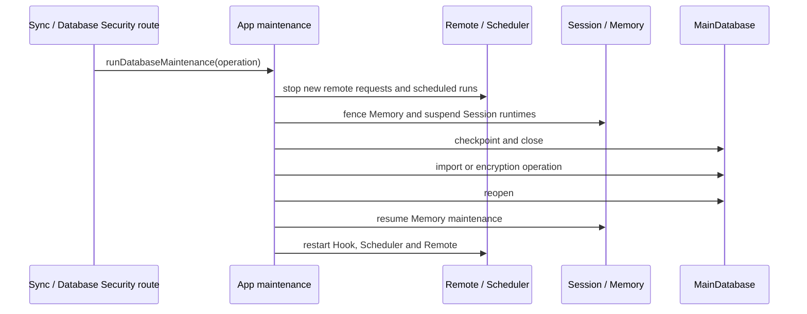
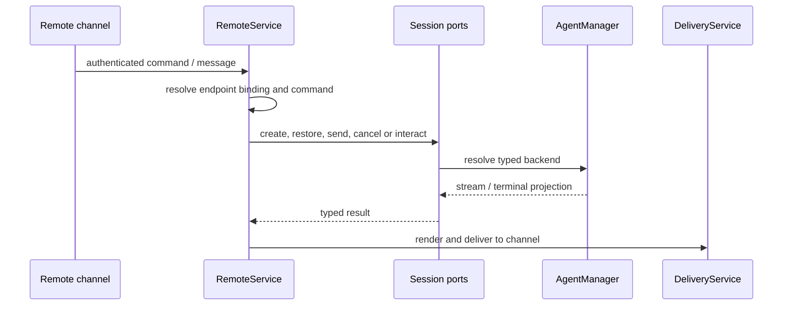

# DeepChat 当前核心流程

These flows use the default Rust/Rutis Core owner. Business state, configuration and the shared
writer live in Core; Native presentation and authenticated renderer ingress remain in Main.
The old `Presenter`, generic lifecycle hooks and global `EventBus` are removed.

## 1. main 进程启动



Database/config migration, required startup migrations and business route registration precede
business readiness. Core owns deferred/background work and its readiness/drain coordinator.
Quit during startup cancels pending/future unlock or recovery requests, then waits for profile
retirement. Startup cancellation does not display a failure dialog. Other business flows below run
in Core and use typed Main ports when they require Native effects.

## 2. 创建 Session 并发送消息



Desktop、Remote 和 Scheduler 共用同一套 Session 生命周期。Scheduler 每次运行创建新的 detached
Session；Remote 保存自己的 endpoint binding；Desktop 只保存 renderer binding。

## 3. DeepChat 执行



Provider、Tool、Skill、Memory 和 Session data 都通过创建时传入的必需接口使用。DeepChat runtime
不能从 App、Routes、Desktop、Remote 或 Scheduler 查找依赖。

- `generationSettings` 在 Session 创建、草稿和 active Session 中统一传递，包括 system prompt、
  temperature、topP、max tokens、reasoning effort 和 verbosity。
- `providerRoundCount` 按 outer round 递增，`requestSeq` 按实际 Provider attempt 递增；strict retry
  不会伪造新的 outer round。
- Memory prompt contribution 必须等待结果、清理内容、限制大小并允许失败；terminal extraction 在后台
  执行，并保持 epoch、cursor 和 fence 约束。
- `TapeToolFactWriter.appendToolFact` 在 message projection 完成后写 terminal tool call/result；
  写入失败不影响当前回复完成。

## 4. ACP 执行



Direct ACP 不进入 `DeepChatLoopEngine`。`kind=deepchat + providerId=acp` 仍是独立的兼容组合，
它使用 DeepChat loop，并把 ACP 当作 Provider。

## 5. Tool、MCP、Skill 和 Plugin



Tool owns catalog assembly, permission checks, and execution routing. MCP owns server/client
lifecycles. Skill owns global packages and physical roots; Agents own logical bindings and their
independent enabled selections. A Run receives the closed intersection of persisted Session
selection and the current Agent's valid enabled catalog. Transfer, rebind, and Subagent entry
recompute that intersection. A missing manual Agent scope does not fall back to built-in
`deepchat`. Plugin registers package capabilities without owning MCP, Skill, or Tool runtime state.

Skill import explicitly selects a target Agent, previews the operation, and repeats validation in
Main before staging an independent package snapshot in the shared root and binding it to that
Agent. Source edits and deletion do not propagate into the imported package. See the
[shared Skills contract](./architecture/shared-skills/spec.md).

模型只能看到 `tape_search` 和 `tape_context`。Subagent 完成后，父 Session 保存指向 child Tape
固定 head 的 link；查询时通过明确的 linked Tape view 读取，不把 child entries 复制到父 Tape。
`subagent_orchestrator` 只在当前 Agent policy 开启且存在有效 slot 时提供，Subagent child 不能继续递归
创建 Subagent。

## 6. renderer binding



普通列表、历史和 binding 查询不会载入 Agent instance。只有执行、完整 restore 或明确的 backend
设置操作可以 hydrate runtime。

## 7. 数据库维护



维护期间新的 `chat.*`、`sessions.*`、`remoteControl.*` 和 `cronJobs.*` route 会被拒绝。
恢复失败时 App 进入 failed 并停止，不在关闭了一半的数据库上继续运行。

## 8. Remote



Remote 负责 channel runtime、endpoint binding、授权、命令解析和结果发送；它不拥有 Session 或 Agent
状态。`/agent` 只通过 Session assignment 选择可用 Agent。Feishu/Lark scan auth 的 begin/poll/cancel、
host 选择和 `open_id` pairing 保持在 Remote channel adapter 内，token 和 pairing secret 不进入 renderer
或聊天文本。Window 关闭不终止 Remote-bound Session。

## 9. Scheduler

Scheduler 查询到期 job 后，为每次 run 创建新的 detached regular Session：

```text
find due job
  -> acquire run identity and timeout
  -> create detached Session with saved Agent/settings/project
  -> SessionTurn.send
  -> wait for terminal result or cancel
  -> persist run status
  -> optional Remote delivery
  -> compute next run
```

Job、run、retry、timeout 和 delivery 由 `src/main/scheduler/` 负责。Scheduler 使用与 Desktop/Remote 相同
的 Session lifecycle，不直接构造 Agent runtime，也不复用上次 run 的 Session。Database maintenance 和
shutdown 会先停止接受新 run，再等待或取消已接收 run。

## 10. Sync 和导入

Core invokes `src/main/sync/` for local backups, database import and S3-compatible cloud sync under
database maintenance. Cloud sync reads endpoint/bucket/path/credentials, creates or reads the
encrypted backup, transfers and validates it before replacing local data. Core owns durable
credential access; Main supplies Native encryption. Maintenance and shutdown fence credential
generations, and the renderer receives only redacted state.

导入成功后重新打开数据库，各模块通过稳定 database owner 读取新 table；长期运行对象不能继续缓存
旧连接产生的 table。任何 close/import/reopen 失败都会让 App 进入 failed 并停止，不执行半恢复。

## 11. 退出

`before-quit` 先询问 Knowledge 是否允许退出。确认后，`MainProcessControl.stop()` 只运行一次，
并按明确顺序停止：

```text
cancel startup work
  -> stop Scheduler / Remote / Hook
  -> suspend Session runtimes
  -> stop Plugin / MCP / browser / Desktop resources
  -> stop Workspace / Skill / watcher / exec host
  -> fence and drain Memory
  -> stop Knowledge / Provider / ACP
  -> close SQLite
  -> destroy shortcut / notification / tray
```

更新安装复用同一条停止路径。数据重置和 App restart 也先完成停止，再由 Device 执行最终操作。
