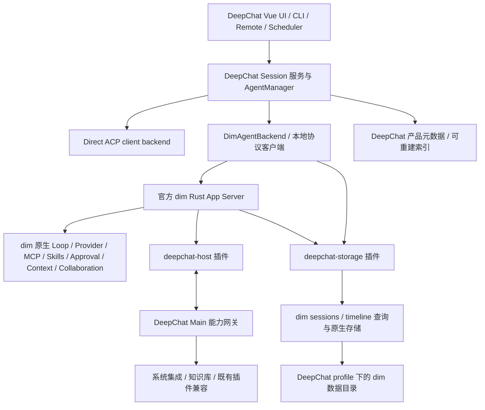

# DeepChat 以 dim Rust 替换内置 Agent Harness

状态：实施 RFC，尚未迁移产品代码。执行顺序与完成状态见 [plan.md](./plan.md)。

## 1. 决策与范围

**dim 已能完成的功能交给 dim 原生能力或 dim 插件完成；DeepChat 不再维护第二套 agent harness。**

目标形态：DeepChat 是桌面产品壳，保留 UI、窗口、系统集成、数据生命周期管理，以及外部 ACP agent 的 client 控制。内置 DeepChat agent 的 loop、agent/session 执行、模型调用、上下文构造、压缩、工具调度、权限等待与恢复，由 dim Rust 承担。通过 dim 的插件扩展产品能力，不把旧 harness 搬进名为 plugin 的目录继续运行。

四项交付：

1. 优先打包官方 dim Rust release，以独立 App Server 进程运行；Electron 不链接 Rust ABI，也不依赖终端 UI。
2. 单独交付 `deepchat-host` dim 插件，承接 dim 未覆盖的 DeepChat 系统能力、既有插件格式兼容和内置工具。原生 MCP、Skills 等功能优先归 dim。
3. 新 session 停止写旧 Tape；复用 Inspector 的 UI 与交互，改为 Timeline Inspector。旧 Tape 仅保留历史读取和迁移用途。
4. 单独交付 `deepchat-storage` dim 插件。DeepChat 管理 profile、数据目录、迁移、备份、同步、删除与凭据策略；dim 内容通过插件向 dim 查询。dim 原生存储是新 agent 内容的唯一事实源。

这里“DeepChat 管理存储”指产品对数据的生命周期和存放位置有控制权；dim 仍是自己物理格式的唯一写入者。**不把 dim SQLite 搬回 DeepChat SQLite 后双写，不让 Electron 直读 dim 私有表。** 如果必须由 Electron 的数据库连接提交每一条 dim 事实，则需要 dim Rust 存储注入扩展，当前官方 release 不能直接实现；这不是本方案默认实现。

本轮交付是完整实施方案及可行性证据。后续实现按门禁逐阶段推进；保留现有可用能力是正式切换的前提，不以隐藏入口代替兼容。

## 2. 调研基线与证据

核对日期：2026-11-09。DeepChat 已 fetch 远端 `dev`，方案分支为 `docs/dim-rust-harness-migration`。

| 对象 | 锁定依据 | 使用边界 |
| --- | --- | --- |
| DeepChat `origin/dev` | `42569d6a8f2128ac9c60daf7c4f15706894ccb04` | 本文现状、功能和路径基线 |
| dim 最新抓取的 `main` | `157d0fc642e9be6f7ab0f58f49fc08e75765fe76` | 识别演进和缺口，不能当作 release 已支持 |
| dim `v0.1.0-alpha.21` | release manifest 的 `sourceCommit`：`0423b321abc923900525d79d030fd690110f91c4` | 首个集成候选，非已批准的生产版本 |
| Linux x64 release | `dimcode-linux-x64-0.1.0-alpha.21.tar.gz`；SHA-256 `b38f8a68f75b9199a1b4c37053db716c077f09b72c29df5829907623692a02df` | 已与 release `SHA256SUMS` 比对并执行 |

[Release 资源](https://github.com/arcships/dim/releases/tag/v0.1.0-alpha.21) 包含 macOS/Linux/Windows 的 x64/arm64 原生包、manifest 和 SHA256SUMS。实际二进制报告 `0.1.0-alpha.21`；该 tag 的 Cargo/npm 源模板仍含 `alpha.18`，因此**必须联合校验二进制版本、manifest、源码 commit、插件 SDK 和能力，不只读 package.json**。

已在临时独立目录执行 release 的 `dimcode app-server --mock-model --home … --unix … --no-ws`：

- 协议 v3 `hello` 成功；无需编译 Rust、无需启动 TUI。
- `session.create`、`session.attach`、带 `submissionId` 的 `session.submit` 成功。
- `session.idle` 到达终态；`session.history` 返回 15 个公开事件，含实际 `step/text` 的 mock Echo 和 `turn/end`。
- `session.input_lookup` 返回该输入已 accepted。
- 正常 shutdown、同目录重启后，在相同 `through` 下返回完全一致的 15 个历史事件。
- v3 提交必须显式带 `branchId`，已验证 `main` 分支；不能套用 v1 参数。

以上证明 release 本地控制、Rust loop 的 mock 执行和持久历史读取可用；**未验证**真实 provider、工具审批、DeepChat 插件加载、完整原始 timeline 查询、崩溃恢复、其他五个平台或 DeepChat 集成。公开 history 事件数量不等于底层全部事实数量。

主要上游依据（固定到 release 源码）：

- [App Server 与本地协议](https://github.com/arcships/dim/blob/0423b321abc923900525d79d030fd690110f91c4/crates/dim-app-server/README.md)、[协议类型](https://github.com/arcships/dim/blob/0423b321abc923900525d79d030fd690110f91c4/crates/dim-app-server/src/protocol.rs)。
- [插件契约](https://github.com/arcships/dim/blob/0423b321abc923900525d79d030fd690110f91c4/docs/design/plugin-contract.md)、[TS 插件写法](https://github.com/arcships/dim/blob/0423b321abc923900525d79d030fd690110f91c4/docs/typescript-plugin-authoring.md)、[SDK](https://github.com/arcships/dim/blob/0423b321abc923900525d79d030fd690110f91c4/npm/plugin.d.ts)。
- [存储装配](https://github.com/arcships/dim/blob/0423b321abc923900525d79d030fd690110f91c4/crates/dim-app-server/src/lib.rs)、[timeline 持久化](https://github.com/arcships/dim/blob/0423b321abc923900525d79d030fd690110f91c4/docs/architecture/rust-agent/timeline-storage.md)。
- [发布与兼容约束](https://github.com/arcships/dim/blob/0423b321abc923900525d79d030fd690110f91c4/docs/release/README.md)：timeline query 形状曾发生破坏性变化，原生存储 v36 不支持旧二进制打开。
- [ExternalAgent 草案](https://github.com/arcships/dim/blob/0423b321abc923900525d79d030fd690110f91c4/docs/design/plugins/ExternalAgent.md)：不能视作已实现的 ACP member 插件接口。main 的新增 EventHub 也不能算作 alpha.21 能力。

## 3. 现状与替换边界

当前入口是 `src/main/app/composition.ts` → `AgentManager` → `deepChatAgentBackend` / `directAcpAgentBackend`。现有 main-host、harness、Tape 合同在迁移上线前继续生效。

| 当前所有者 | 目标所有者 | 迁移后的职责 |
| --- | --- | --- |
| `agent/deepchat/{harness,loop,runtime}` | dim Rust runtime / capabilities | 最终移除旧执行路径；TS adapter 只做命令、身份、事件和 UI 投影 |
| `provider/aiSdk`、内置 agent 调用的 Provider | dim Rust Aimux / provider 插件 | 请求构造、流、retry、工具协议、token/usage 均在 Rust |
| `AgentManager`、Session 产品服务 | DeepChat | 稳定产品 session ID，路由到 dim 或 Direct ACP，不推进执行状态机 |
| `agent/acp`、`directAcpAgentBackend` | DeepChat | 外部 ACP 的连接、鉴权 UI、资源、终端、工作区和扩展支持 |
| `mcp`、`skill` 中的通用执行/管理 | dim 原生 MCP / Skills 插件 | DeepChat UI 调原生管理接口；一次性导入旧设置后不再双向保存 |
| DeepChat 内置 MCP、知识库、平台集成、CUA 等 | `deepchat-host` → 既有产品服务 | 只导出缺失的能力，不重建通用 MCP manager 或工具 loop |
| `session/data`、Sync、导入导出 | DeepChat + `deepchat-storage` | 产品元数据归 DeepChat，dim 内容经 dim API；投影可重建 |
| `tape` 的写入、journal、provider view | dim timeline / 原生恢复 | 旧 Tape 对新 session 不再是执行依赖 |
| `components/tape-inspector` | Timeline Inspector + 两种只读来源 | 保留 UI，替换身份、查询、关联及事件解释层 |

## 4. 目标架构与运行方式



每个 DeepChat profile 一个受监督 dim 进程，多 session 复用；不按消息 spawn CLI、不解析终端文本、不通过 ACP 包装 dim 以牺牲管理和 timeline 能力。Direct ACP 仍走独立 backend。

### 4.1 进程与协议

- Linux/macOS 使用私有 Unix socket + NDJSON；Windows 使用限制到当前用户的 named pipe。生产 `--no-ws`。dim product/configured profile 的 WS 不能作为通用执行接口。
- 显式 `--product-home <profile>/dim` 和 `--home <profile>/dim/rust`。测试用 `--mock-model` 或本地 mock provider；生产不带 mock。
- main 中新增 `DimRuntimeSupervisor`、`DimRpcClient`、`DimAgentBackend`。沿用现有 `DeepChatSessionHandle` 的外部调用面，逐项适配；不强行复用依赖 Tape 的内部 port。
- 启动等待 socket → `hello` → 校验二进制/协议/功能 → 两插件 readiness → 恢复映射 → 接受命令。失败显示可定位错误，不自动回落旧 harness。
- `hello.features` 只表示协议能力的一部分；Session 插件方法用 `session.methods` 发现，插件另提供版本与能力查询。新插件自定义方法是本 RFC 的拟实现合同，不是上游已有方法。
- 断线标记 unavailable/reconnecting，不把正在运行的回合改成成功；重连校验 `instanceId`，重读快照与游标。保留 dim 的真实终态。
- 退出先停新 admission、结算或明确中断任务、卸载桥接、等待 dim graceful shutdown completed，再关闭产品数据库。超时强杀视为异常恢复，不能证明 flush 成功。
- 使用当前 child-process registry 管理进程树；网络代理、CA 信任、shell 环境和工作区隔离须跨 Node/Rust 一致。

### 4.2 Release 管理

新增可审计的 runtime lock manifest：版本、source commit、目标平台、下载 URL、包 SHA-256、协议范围、SDK/rutis/runtime 版本、插件 digest、存储兼容版本。默认锁定版本随 DeepChat 发布更新，不跟随 latest 自动换包。

安装器下载到 staging，校验来自受信发布渠道且已固定的摘要，解压路径校验，执行 `--version` 与握手后原子激活。包连同许可证、notice 一并打包；离线启动不下载。受 macOS 签名/notarization、Windows 签名和 Linux glibc 约束的可执行文件纳入原有打包流程，不能只验证开发机。

TS 插件通过 App Server 的 `--session-rows`、`--node`、`--js-runtime` 接入；注意这是 `app-server` 参数，不是旧版顶层 CLI 参数。固定与 host 匹配的 rutis 和声明，验证独立 Node runtime 的打包、寻址与生命周期；不得假设 Electron 自带的 Node 可直接作为受支持插件进程。

优先顺序：**已有 release + 外置插件 → 上游补通用扩展并发布新 release → 临时从固定 commit 构建的薄 host**。最后一条只在 release 无法满足硬性门禁时启用，需在实施记录中说明缺口和退出条件；不得 fork 一套 loop，也不得把“源码有接口”写成“release 已支持”。

## 5. 插件设计：扩展能力，不扩展第二套执行权

两个插件独立包、独立版本、独立故障域，使用 dim plugin loader。一条 process row 按需注册 Session/branch parts；生命周期、卸载、reload 和 scope 由 rutis 管。初期放在 `plugins/dim/deepchat-host/`、`plugins/dim/deepchat-storage/`，不与现有 `.dcplugin` 或 `.codex-plugin` 格式混淆。

### 5.1 deepchat-host

提供内容：

- DeepChat 专有系统操作、通知、文件选择、浏览器/CUA、平台能力、内置知识库检索、尚无 dim 对应物的外部插件工具。
- 既有插件安装与 consent 兼容。可转换为 dim 原生 MCP/Skills/Hooks 的配置优先转换；仅无法等价映射的部分走兼容 adapter，记录来源和退出条件。
- DeepChat UI 的权限和问题交互适配、外部 ACP member 集成的产品一侧。
- 必要的产品配置导入、工作区授权和凭据绑定。模型请求不得从这个插件回调旧 AI SDK。

现有 TS SDK 可注册 `toolRegistry` 工具、`managementMethods` / `sessionMethods` 方法、`partRegistry` 分域组件，并经 `dispatcher.consume`/`timeline.query` 读取事件。`before`、动态 prompt/tool source 等部分仍有 Rust-only 边界；需要同步拦截或请求构造时，优先扩展 dim 的原生 owner，不能用异步通知冒充拦截合同。

DeepChat Main 提供受限双向本地网关；这是拟新增产品协议，不是 dim RPC 自带的反向 Electron 调用。能力以 `deepchat.*` 命名，由插件注册具体工具；不提供接受任意方法名、SQL、路径或 shell 的万能调用。

每次调用绑定 profile、appSessionId/dimSessionId、branchId、turn/request/toolCall ID、plugin generation、取消信号和授权范围；网关验证其会话映射、版本和有效期。进程重启/插件撤销使旧句柄失效。没有实际副作用完成证据时返回 unknown/interrupted，不重试可能已完成的写操作。

权限决策归 dim Approval；DeepChat 原生服务额外执行自身文件/窗口/来源检查。两个许可取交集，不能相互扩大；不因桥接存在就打开全局 full-access。工具 schema、风险、资源范围与来源保留，MCP 的 readOnlyHint 不能提升并行和写权限。

### 5.2 MCP / Skills 的最终归属

dim 已有 `mcp.catalog/configuration/save/update/remove/inspect`、OAuth 和 Session 工具接入，也有 Skills catalog/启用/refresh。故默认方案是：

1. DeepChat 现有设置页、发现、安装 UI 保留；main routes 改调 dim 管理接口。
2. 旧用户/项目/插件配置及安全凭据迁移到 dim 对应来源，保留来源优先级、版本 CAS、禁用状态和安装 consent。
3. 通用 stdio/HTTP/SSE server 的连接、重连、认证、工具发现、取消归 dim。每个 server identity 只有一个运行 owner。
4. DeepChat in-memory MCP、企业身份和尚不兼容的 MCP Apps 等作为明确的桥接能力保留。能迁入 dim 原生 MCP 后移除 adapter；不通过两个 manager 同时连同一 server。
5. 原有插件的 Skills/Hooks 接入 dim 的对应 owner；保持撤销、更新期间冻结、context 来源、调用次数与预算语义。禁用插件必须撤销新调用和过期授权。

### 5.3 deepchat-storage

是数据访问与产品生命周期插件，不是复制 timeline 的监听器。由 DeepChat main 在启动前解析和创建根目录，作为不可变启动配置交给 dim；插件加载发生在存储打开之后，不能声称它动态替换了已经装配的 SqliteStoragePlugin。

插件职责：

- 握手校验 profile、store identity、布局版本与允许的数据根，向 DeepChat 提供受限存储能力合同。
- 通过 dim `sessions`、`timeline.query`、原生历史/分支接口读取 session 内容、细节、usage、搜索和 export 所需数据；裁剪、脱敏后返回。冷 session acquire/release，读失败与空结果分开。
- 提供拟新增 `deepchat.storage.capabilities`、`deepchat.storage.sessionPage`、`deepchat.storage.eventDetail`、`deepchat.storage.exportSession`；分支查询用 Session part 注册的 `session.deepchatStorage.*` 方法。具体 wire schema 在第一实施阶段固定。
- 这些接口中的查询投影只能表达读取/序列化，不得构造模型请求、推进 loop 或直接改写 dim 事实。
- 备份/删除/迁移由产品 coordinator 发起，优先调用 dim 原生命令；需要宿主级原子能力时列为上游扩展，不能伪装成 TS 插件已具备。

**明确限制：** `pluginFiles` 是插件自有文件存储，并非可替换 `TimelineStore`；当前 release 在 Rust 装配 native SQLite。若未来有外部底层存储需求，必须实现 Rust 层的提交/发布、原子批次、查询、恢复和关闭合同，另作决策，不在 Electron 侧模拟。

### 5.4 配置和模型调用

dim 管理模型配置和执行；DeepChat 保留设置 UI、产品预设与安全存储策略。导入 provider 配置后只通过 dim 管理接口写 provider 连接/模型偏好，避免两份 live authority。DeepChat 只保存产品映射和索引。

逐 provider 核对 OpenAI Chat/Responses、Anthropic、Gemini/Vertex、Bedrock、Ollama、OpenAI-compatible 与现有特殊 provider（含 Copilot、Codex OAuth、Jev、Workers AI、媒体 provider 等）。同为 OpenAI-compatible 不等价：自定义 headers、代理、OAuth refresh、特殊 tool/result 语义、推理字段、cache usage 和错误类型都需要对应。

发现缺口时在 dim Rust provider/Aimux 或 dim 原生 provider plugin 补齐；不可把 dim 的 model tool 接回旧 TypeScript Provider 实现。模型路由和限流归 dim；主对话之外的标题、摘要、翻译、建议、记忆提取、embedding/rerank、图像/语音调用也要登记并迁入 dim 的 auxiliary/model/modality 能力。非模型的知识索引、向量存储和系统工具可继续由产品服务持有。

dim 当前 TS 插件无通用凭据服务。不能把完整秘密写到插件 row config、argv、timeline 或日志。优先 dim 原生 secret storage/安全导入；若需保留 OS keychain 为权威，则补 dim Rust 端受限 credential resolution 接口（短期凭据仅进程内使用、目标 host 绑定、轮换可撤销）。该项须验证后才切换相关 provider。

## 6. 数据布局、读取和一致性

```text
<DeepChat profile userData>/
  <existing product database/settings>  # session 元数据、窗口、业务配置
  dim/
    runtime-lock.json                   # 实际激活的版本和格式（无凭据）
    rust/dimcode.sqlite                # dim 唯一写入；名称以锁定版本为准
    <dim-owned files and artifacts>/    # 原生管理，路径不由 renderer 拼接
  runtime/dim/<version>/<platform>/     # 安装器管理的已校验包或打包资源映射
  migration/dim/<migration-id>/         # 迁移日志、映射、校验结果
  backups/<backup-id>/                  # 产品一致性快照
```

socket 放 OS runtime/temp 私有短路径，避免 Unix 路径长度限制；元数据绑定 profile hash，Windows pipe 同样隔离。不得写用户全局 `~/.dim`；现有 `~/.deepchat/sessions` offload 要登记、迁移或保留兼容引用，不能假设全部旧内容都在 userData。

### 6.1 单一事实源

- dim：新内置 agent 的输入、事件、分支、请求/工具事实、compaction、恢复状态和原生持久内容。
- DeepChat：app session ID、文件夹/置顶/标题显示策略、窗口、ACP 会话元数据、导入来源、映射与内容引用、跨后端搜索投影。dim 的原生自动标题可投影，用户显式改名经选定 owner 写一次。
- DeepChat 的 transcript/search/usage 缓存必须可从 dim 重建，标记来源 `engine + storeId + sessionId + branchId + cursor + projectionVersion`。禁止作为 dim 下一次请求的上下文来源。
- 数据库之间没有共享事务。dim commit 是运行事实成立点；投影和 cursor 在 DeepChat 自己一个事务内提交，崩溃后从 cursor 补读。投影失败不撤销已提交工具结果。
- 存储插件不可用时阻止内容型操作并显示明确错误，不能用旧缓存假装已与 dim 同步。

### 6.2 提交、事件和重连

本地先持久化稳定 `submissionId` 及未确认发送意图，再提交 dim。wire RPC id 只是相关性 ID。明确的 admission reject 才可判定未接受；断线、publication/storage error 或不确定回复先 `session.input_lookup`，不能盲目 resubmit。lookup 本身不代表服务器支持幂等再次提交；自动重试前须验证相同 ID 的实际合同。

attach 与历史补读需要无缝边界：先建立监听并暂存实时事件，取得固定水位，再补页并按身份去重；如原生 attach 合同不能覆盖该窗口，在插件中提供 snapshot+cursor+subscribe 合同。不能以时间戳去重；保存连续处理的有效游标，不假设 `session.history` 每一个整数 sequence 都有可见行。保留 `nextAfter`/`through` 语义和原子批次边界。

每个 dim session 同时只有一个执行持有者。跨窗口、CLI、Remote 的引用计数属于 DeepChat host，不因关一个窗口就 stop。session delete/restore 使旧 generation 失效，晚到事件不得污染同名新 session。

### 6.3 备份、同步、删除和恢复

首版采用可证明的一致性屏障：阻止新写入 → 处理运行/审批/后台工具 → graceful shutdown completed → 复制全部 dim 数据闭包和 DeepChat 映射/元数据 → manifest+校验 → 重启。插件只为内容导出提供只读 API；没有已验证的在线 snapshot API 时，不承诺流式运行中热备份。不得只复制运行中 `.sqlite` 而遗漏 WAL 和外部 blob。

后续需要无暂停在线备份时，在 dim 存储 owner 中实现固定水位 snapshot/export 与文件闭包清单，再由 storage 插件提供受控入口。无法达到现有备份使用体验的部分要列为 G6 切换门禁。

Sync 仍由 DeepChat 管，但不对活跃 dim DB 做文件级合并；同步一致性快照或 dim 可导入的不可变内容包，冲突生成独立 imported session。定义设备/store identity，恢复不能同时运行两个 writer。

删除先冻结并 tombstone 产品映射，再经 dim 删除并处理 artifact 引用，最后清理 DeepChat 索引。用持久 operation ID 恢复中途失败；共享附件按引用释放。加密、备份密码、个人数据删除政策覆盖 dim 数据和日志；若现有加密无法覆盖新 SQLite，则必须补齐，不能因换引擎退化。

版本回滚必须恢复升级前**整套**数据与二进制快照。旧 dim 不能打开新格式；旧 DeepChat 不能继续写 dim 已接管 session。回滚后的新消息不得被静默丢弃，应保留升级后快照供重新导入。

## 7. Tape 退化与 Timeline Inspector

### 7.1 Tape 退役

新内置 session：dim timeline 是执行事实源，停止旧 Tape 的 append/reconcile/view assembly/journal 写入；删除这些执行依赖前先完成 crash/queue/permission 验收。DeepChat 可重建投影不命名为新 Tape。

旧 session：保留只读 Tape reader、历史 trace 和来源映射。Direct ACP 现有 `linkSubagentTape` 等关联改成产品 lineage metadata，不为 ACP 再建一个 dim loop 或新 Tape writer。最后删除没有调用者的旧运行代码与表写入器，不删除仍被历史读取需要的数据。

### 7.2 可复用与必须替换

| 层 | 复用 | 必须改变 |
| --- | --- | --- |
| Panel、Timeline、Row、DetailPane、列宽/layout | 虚拟化、筛选 UI、选择、跟随/暂停、按需详情、导出体验 | 文案/i18n、分支选择、来源标识 |
| `store.ts` / `model.ts` / `timeline.ts` | 纯 UI 状态和通用展示算法，逐项验证 | `entryId` 数值身份、incarnation、分页 cursor、run/attempt 关联 |
| `traceInspectorProjection` | 有界化、脱敏、异常/未知状态处理思想 | dim 事件语义解释；旧字段不能直接套 dim |
| `traceInspectorService`、head watcher、Tape ports | 旧历史 reader 留存 | 新数据全部经 storage 插件读取，watch 只跟随 committed/published 数据 |

“复用大部分逻辑”适用于展示和交互；不能承诺 Tape 数据语义可直接复用。保留 `LegacyTapeReader` 与 `DimTimelineReader` 两个只读来源，统一到新的 `TimelineInspectorRecord`，不把 dim 事件伪造成旧 `DeepChatTapeEntryRow`。

拟定统一身份：

```ts
type TimelineIdentity =
  | { source: 'dim'; storeId: string; sessionId: string; branchId: string;
      sequence: string; eventId: string }
  | { source: 'legacy-tape'; incarnationId: string; entryId: number }
```

sequence 在 JS 边界使用无损十进制字符串；须核对锁定协议的 u64 编解码，禁止超出安全整数后仍以 JS number 比较。dim 分支内顺序按发布 sequence；跨分支按因果引用/树展示，不能按墙钟时间拼出虚假的全局执行顺序。cursor 包含来源、store generation、branch、固定 `through` 和 query hash，切分支/筛选使 cursor 失效。

事件例：`input/message`、`turn/*`、`step/text`、模型开始/结束、tool、approval、context compaction、branch、collaboration。完整覆盖按锁定 SDK/event schema 映射，未知事件保留有界 metadata。使用 `turn_id/request_id/tool_call_id` 等真实关联，缺失标为 unavailable/unbound；不从相邻事件推断 duration、attempt 或成功状态。

timeline query 与公开 `session.history` 用途不同：history 用聊天；Inspector 需插件通过 timeline 查询全部允许的已提交事实。列表 metadata-only，详情按需且脱敏；上下文、Skill 和凭据边界保持现有 Inspector 约束。原始 dim export 可能包含提示词/代码/工具正文，不能直接用作“脱敏支持包”。

### 7.3 旧历史与续聊

不批量把旧 Tape JSON 直接塞进 dim timeline，也不使用“最后几条消息”冒充完整迁移。

1. 所有旧对话先可读、可检索、可导出；当前未结算运行标记 interrupted，旧持久队列维持显式恢复要求。
2. 需要续聊时创建 migration record 和新 dim session，按稳定 ID 映射输入、assistant 内容、tool call/result、附件、分支 lineage、设置、有效摘要和来源。
3. 通过 dim 正式 import/migration owner 导入可重放的历史语义；若锁定 release 不支持 DeepChat 格式，在 dim 端补导入能力。不能让普通插件伪造保留域 runtime events 或再次执行历史工具。
4. 不能保留 provider 私有 replay 格式的内容明确标记；原文/原始证据仍由 legacy reader 可读。必须证明导入后上下文、有效压缩边界、消息变体及附件引用可继续使用。
5. 校验计数、hash、工具配对、来源与附件闭包，原子切换 session engine mapping；失败保留旧 reader，不留下半迁移可执行会话。
6. migration key 由旧 session identity、revision、格式版本组成；重复执行无重复 session/内容。支持 dry run、分批续跑、失败隔离和磁盘空间预检。

只有只读旧历史而无法无损续聊属于未通过门禁。显式“新建关联会话”的 fallback 可先提供给试用者，但不计为完整迁移达成。

## 8. 功能保持与缺口处理

分类：**N** 使用 dim 原生 owner；**P** 使用产品插件；**G** 需要上游补齐或验证，关闭前不全量切换。以下是能力归属与上线标准，不是测试用例清单。

| 能力 | 路径 | 必须保持的产品行为 |
| --- | --- | --- |
| 文本/推理/工具流、停止/继续、错误恢复 | N + adapter | 消息块顺序、usage、取消、失败可见，不因断线重复工具 |
| send/steer/queue/retry/edit/reorder | N/G1 | dim 已有 pending/withdraw/steer；旧队列编辑、排序、重启 hold 需要逐项等价，不维持 TS 第二 pump |
| 系统提示、AGENTS、Skill、插件 context | N/P/G2 | 作用域、来源、token 预算、撤销与 refresh 时序保持；PromptRegistry 跨语言不足则补原生扩展 |
| 自动/手动压缩、上下文占用、长对话 | N | summary 与快照分离，压缩后追溯、取消和失败行为不退化 |
| 通用 MCP 与 Skills | N | 既有设置、scope 优先级、OAuth、企业身份、禁用状态和重连语义保持 |
| 内置知识库、MCP Apps、浏览器/CUA、平台服务 | P/G2 | 原 UI、隔离边界、tool schema、进度、取消、外部副作用状态可用 |
| Provider 与模型参数/OAuth/代理/headers | N/G3 | 按实际 provider/功能清单验证，缺口迁到 Rust；无 TS model fallback |
| 图像/附件/OCR、音频/视频与生成 | N/P/G3 | 不静默丢附件，不用纯文本替代成功，二进制结果的存储与展示完整 |
| 标题/翻译/建议/记忆模型/embedding | N/G3 | 所有模型工作在 dim，UI 及非模型知识/记忆存储可在 DeepChat |
| 内置 subagent / branch / fork / transfer | N/G4 | 等待、取消、消息、权限、模型选择及 lineage 保持，禁止搬旧 scheduler |
| Direct ACP client | DeepChat | 认证、终端、工具/UI 扩展、工作区、取消、重连继续工作 |
| dim 委托 ACP agent / ACP-as-provider 旧配置 | G4 | ExternalAgent 尚为草案；优先 dim Collaboration member 扩展。原 ACP-as-provider 不能静默转为不等价委托，需迁移说明和用户可确认的映射 |
| 旧历史续聊、编辑/重生成/变体、收藏与搜索 | P/G5 | 导入与 branch/fork 语义明确，引用可追踪；历史工具不重放 |
| 备份/同步/加密/删除/崩溃恢复 | P + native storage/G6 | 同一数据闭包、无双 writer、失败可恢复、磁盘故障不报成功 |
| Timeline Inspect 与请求 trace | N/P/G7 | 全部允许的事实、精确关联、分页/跟随、原有脱敏；缺失证据明确展示 |
| 多窗口/CLI/Remote/计划任务/后台执行 | N/P/G8 | 同一 Session 命令边界；headless、通知、授权和关闭行为保持；不得因 main 新 EventHub 存在就假设 release 有 |

G1–G8 必须在计划中有负责边界、验收和删除兼容路径条件。原有行为基线以当前用户 workflow 与稳定合同为准，不把旧私有函数实现一一复制。原有能力如果不再适用，需要产品明确接受后才能改变，不由工程单方面降级。

### 8.1 如果立即替换当前 harness，会有哪些功能风险

本 RFC 不批准主动删除功能；当前只提交方案，因此现有产品行为没有改变。但不能把 alpha.21 的基础回合验证视为全功能可替换：

| 状态 | 具体能力 | 直接切换的后果与处理 |
| --- | --- | --- |
| 已知扩展边界 | TS 插件替换底层 TimelineStore、同步 before、部分 prompt/tool source | 当前不能仅靠外置 TS 插件完成。默认保留 dim 原生存储写入；确需这些扩展则在 dim Rust owner 补齐 |
| 已知上游尚为草案 | dim 向外部 ACP agent 委托 | ExternalAgent 不能作为现成能力接入；需完成 Collaboration member 扩展。DeepChat 独立 Direct ACP client 不因此缺失 |
| 缺少完整等价证明 | 队列编辑/排序/重启 hold，旧 ACP-as-provider | 不能用 pending/withdraw/steer 或 subagent 委托冒充原行为；实现或验证等价后再迁移受影响 session |
| 需要专用迁移实现 | 旧对话续聊、变体、附件/工具配对、私有 replay | 仅展示旧历史不等于能续聊；需 dim 导入能力及上下文校验，原始证据保留只读 |
| 尚未逐项验证 | 特殊 provider/OAuth、媒体、embedding/记忆、产品插件/MCP Apps/CUA | 不能宣称全部支持，也不能据此认定 dim 没有；逐能力核验，缺口补 Rust provider 或产品插件 |
| 需要跨产品实现 | 一致备份/在线备份、同步、加密、完整 trace/Inspector、多入口生命周期 | 当前 release 的基本存储/history API 不能直接保证 DeepChat 产品行为；完成 G6–G8 后才允许全量切换 |

优先阻断项是旧历史可续聊、现有 provider 能用、工具/插件可用和数据可恢复。未通过的项保持原 session 未迁移；最终完成时必须清除旧执行依赖，不能长期用双 harness 掩盖缺口。

## 9. 安全、性能与故障不变量

- renderer 仍只使用 typed preload/contracts/client；不能获得 socket token、任意文件访问或 dim 原始管理权限。Remote/CLI 的授权继续由 DeepChat 校验。
- dim 插件为受信代码，不是沙箱。内置 bridge capabilities 与第三方包隔离注册，不把 Main 网关凭据或存储根授权送给所有插件。软件包 checksum 不等于 publisher signature。
- 文件读写按真实路径、工作区和 granted roots 校验，拒绝 symlink 穿越；取消/卸载立即撤销未执行能力。工具输出、错误和日志统一限界与脱敏。
- 磁盘满、存储失败、模型中断、进程退出分别呈现；dim 未发布事实不得投影为已完成。消费者落后采用补读而非无限堆积；有界消息队列、字节上限和大内容引用。
- 先记录旧基线，同硬件/fixture 比较 TTFT、流 UI 延迟、停止延迟、空闲内存、长历史页读、并发 session 和包体。建议硬门槛：宿主新增 p95 控制开销不超过 100 ms，主要交互 p95 不劣化超过 20%；超标先解释/优化，不以更换模型掩盖。实际基线不足时不得宣称达标。
- 不承诺网络模型或外部副作用的 exactly-once；稳定输入 ID、执行状态、查询确认、generation fencing 与人工恢复共同处理不确定性。

## 10. 切换、验收和完成定义

阶段试用按 session 固定 `engine=legacy|dim|acp` 和 runtime version。只允许独立 session A/B；禁止同一个用户输入同时真实执行两个 agent。旧 harness 只为迁移期既有 session 保留，不是长期 fallback。

新 session 默认切 dim 的前提：两个插件可用、目标平台包可启动、G1–G8 对发布范围全部通过、既有数据可恢复。最终移除 legacy 执行入口、旧内置 loop 和对应 Provider 调用链；历史 reader 可长期只读保留。

完成必须有以下可核查证据：

1. 内置 agent 和所有辅助模型调用均由 dim Rust 发出，DeepChat adapter 不包含 loop/retry/context/queue 推进代码。
2. 普通 MCP/Skills/Approval/Context/Collaboration 使用 dim owner，剩余 bridge 每项有 dim 未覆盖的产品理由。
3. 主要桌面、CLI、Remote、Direct ACP workflow 保持；所有兼容缺口闭环或有明确产品批准的变更。
4. 新 session 不写 Tape；旧数据可读、可续聊、可检查，Timeline Inspector 可分页跟随新数据。
5. 数据全部在受管理 profile 内，内容查询经 storage 插件；备份/迁移/删除/回滚在故障中可恢复。
6. 六个平台 release 与插件运行时、签名/许可证/离线启动验收通过。跨平台结果必须分别记录。
7. 全变更审查、必要质量门禁与现有行为回归完成；清理临时探针、旧无用执行模块与依赖，更新被替代的维护合同。

当前没有需要用户先回答才可写方案的架构选择。上游扩展可行性和行为等价属于实施门禁；缺口阻止产品切换，不阻止可独立的 adapter、插件和 UI 工作。
