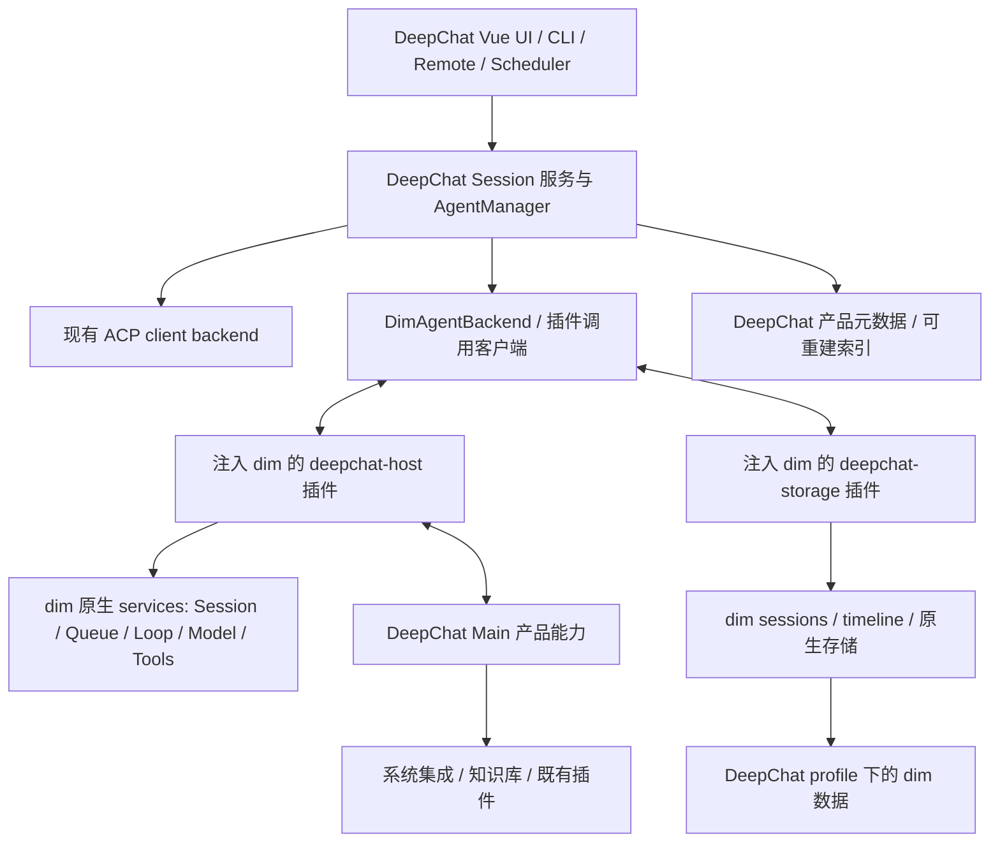

# DeepChat 以 dim Rust 替换内置 Agent Harness

状态：实施与最终验收中。主产品内置 backend 已切换为 dim Rust，旧 Harness、Node 模型执行器与重复内置工具已删除；保留 Direct ACP client、只读旧历史与按需转换器。原生内容的设备同步正在完成联合验收。执行与验证记录见 [plan.md](./plan.md)。

## 1. 决策与范围

**dim 已能完成的功能交给 dim 原生能力或 dim 插件完成；DeepChat 不再维护第二套 agent harness。**

目标形态：DeepChat 是桌面产品壳，保留 UI、窗口、系统集成、数据生命周期管理，以及外部 ACP agent 的 client 控制。内置 DeepChat agent 的 loop、agent/session 执行、模型调用、上下文构造、压缩、工具调度、权限等待与恢复，由 dim Rust 承担。通过 dim 的插件扩展产品能力，不把旧 harness 搬进名为 plugin 的目录继续运行。

四项交付：

1. 优先打包官方 dim Rust release，由 DeepChat 注入插件，在插件代码内直接使用 dim services 操作 agent。release 作为受监督宿主进程运行；跨进程通信只承载插件调用，不经过 ACP，也不依赖终端 UI。
2. 单独交付 `deepchat-host` dim 插件，承接 dim 未覆盖的 DeepChat 系统能力、既有插件格式兼容和内置工具。原生 MCP、Skills 等功能优先归 dim。
3. 新 session 停止写旧 Tape；复用 Inspector 的 UI 与交互，改为 Timeline Inspector。旧 Tape 仅保留历史读取和迁移用途。
4. 单独交付 `deepchat-storage` dim 插件。DeepChat 管理 profile、数据目录、迁移、备份、同步、删除与凭据策略；dim 内容通过插件向 dim 查询。dim 原生存储是新 agent 内容的唯一事实源。

这里“DeepChat 管理存储”指产品对数据的生命周期和存放位置有控制权；dim 是自己物理格式的唯一写入者。DeepChat 经注入的 storage 插件查询 dim 内容，继续管理 profile 与桌面数据操作，不替换 dim 底层存储实现。

聊天 UI、队列、模型与产品辅助入口、旧会话按需转换和一次性解密已接入；设备同步采用原生选择性导出与冷暂存安装，完整验收仍在进行。按用户明确的范围落实以下决定：

- Code Mode 按用户决定暂时不可用，等待 dim 原生实现；不迁移 DeepChat 旧 Code Mode、ToolSearch 或 programmatic dispatch。dim 有同等功能的内置工具直接替换 DeepChat 对应工具，插件只注入剩余产品能力。
- 队列直接复用 dim 的完整实现，DeepChat 只接 UI 和命令，不另建队列或预设上游缺口。
- ACP 完全由 DeepChat 现有 client 负责；不新增 dim ACP gateway、ExternalAgent 或跨 ACP 委托任务，也不经 ACP 与 dim 通信。
- 旧会话在首次续聊前 migration，转换为 dim 的会话内容；历史浏览不触发 agent 执行或全量迁移。
- dim 自身 OAuth 不做适配或重实现；其他产品设置、模型配置和能力通过注入插件交互。
- 兼容桥作为正常插件集成任务，不预先列为 dim 缺失功能。
- 备份、同步、Inspector 和多窗口仍是 desktop 功能；移除数据库内容的持续加解密，只保留旧加密数据的一次性解密迁移。

除明确移除持续加解密外，功能验收关注接入后既有用户操作是否可用，而非要求重新证明 dim 实现了这些功能。

## 当前实现边界

| 入口或数据 | 当前所有者 |
| --- | --- |
| 桌面、CLI、Remote、计划任务 | 现有产品入口经 AgentManager 调用 dim backend；外部 agent 仍走独立 ACP client。 |
| 内置 loop、队列、模型、上下文与压缩 | 锁定的 dim Rust owner；Node 负责配置与授权，不执行模型。 |
| 原生默认工具、MCP、Skills、hooks | dim 原生实现；产品专有能力经 `deepchat-host` 和受限能力网关注入。 |
| 内容、事件与附件 | `deepchat-storage` 调用原生 SessionStore、TimelineStore、FileStorage；不查询 Native SQLite 表。 |
| 产品元数据与只读投影 | DeepChat 的 `app_db/agent.db`；内置内容的事实源位于 `<userData>/dim/rust`。 |
| 备份与恢复 | 冷 Native 快照与产品 SQL 同窗口采集，使用清单、校验、目录安装与恢复日志。 |
| 自动设备同步 | 产品 SQL 批次附独立原生文件清单；稳定闭包导出、有界分块与续传、会话 LWW 冷暂存替换、独立提交回执恢复。 |
| 旧 Tape 和旧加密库 | 保留只读历史与首次续聊转换；旧库/备份一次性解密，不再持续加密新数据。 |

私有桥与插件版本由锁文件校验。当前桥版本为 `0.43.0`，底层 dim source/store 锁定值未随
设备同步模块改变。原生 profile 的唯一写入者仍是 dim；DeepChat 管理目录、生命周期与产品事务。

## 2. 调研基线与证据

核对日期：2026-11-09。DeepChat 已 fetch 远端 `dev`，方案分支为 `docs/dim-rust-harness-migration`。

| 对象 | 锁定依据 | 使用边界 |
| --- | --- | --- |
| DeepChat `origin/dev` | `42569d6a8f2128ac9c60daf7c4f15706894ccb04` | 本文现状、功能和路径基线 |
| dim 最新抓取的 `main` | `157d0fc642e9be6f7ab0f58f49fc08e75765fe76` | 调研参考；接入 SDK 以实际选用 release 为准 |
| dim `v0.1.0-alpha.21` | release manifest 的 `sourceCommit`：`0423b321abc923900525d79d030fd690110f91c4` | 首个集成候选，非已批准的生产版本 |
| Linux x64 release | `dimcode-linux-x64-0.1.0-alpha.21.tar.gz`；SHA-256 `b38f8a68f75b9199a1b4c37053db716c077f09b72c29df5829907623692a02df` | 已与 release `SHA256SUMS` 比对并执行 |

[Release 资源](https://github.com/arcships/dim/releases/tag/v0.1.0-alpha.21) 包含 macOS/Linux/Windows 的 x64/arm64 原生包、manifest 和 SHA256SUMS。实际二进制报告 `0.1.0-alpha.21`；该 tag 的 Cargo/npm 源模板仍含 `alpha.18`，因此**必须联合校验二进制版本、manifest、源码 commit、插件 SDK 和能力，不只读 package.json**。

alpha.21 的 Rust API 已支持完整 `ModelConfig` 和 `ProviderSecretHost`，但当前 TS 插件绑定没有导出这两个入口。因此保留官方 release 安装与回归，同时通过同一 release 的锁定源码装配 `native/dim-host`：增加设置和辅助模型插件；显式启用 stock Provider 的现有凭据引用依赖，并让自定义 Header 的不透明引用通过同一 ProviderSecretHost 在请求时解析；匿名连接如声明产品准入引用，也通过此公开 owner 在每次请求检查当前启停/模型/连接身份，认证模式仍是 Anonymous，不向供应商发送确认值（源码准备脚本精确核对 Provider 装配、Header 引用与匿名引用检查的变更，并拒绝其余 tracked 文件变更）。另在 builder 装配 API 增加显式 per-Session host factory，使用原生 SessionIdentity 替换默认 IdentityContext，让产品插件实现公开 PrepareContext；其独立源码 hash 记入 extensionPatches。原生 context 仍校验固定历史前缀并负责预算/压缩，profile 空闲检查另外复用公开 AgentIndex/Session.in_use、ModalityTasks 与 ProviderService；仅重新导出已有公开 AgentIndex 类型并增加只读 provider 活动计数，不引入第二份任务状态。不修改 loop、队列、context 或模型驱动实现。当前桥版本 0.14.0，包含 Session 产品 ToolProvider、媒体 provider 名称适配和向量插件；媒体任务/连接/驱动复用 dim，向量经过公开非聊天连接 owner 后由同一锁定源码内的 Aimux 执行。二进制 manifest 记录 release、真实 server version、source commit、Cargo.lock/hash 和装配变更 hash，启动再核对插件 provenance。待官方 release 直接暴露这些扩展口后，可移除这个装配例外。

已在临时独立目录执行 release 的 `dimcode app-server --mock-model --home … --unix … --no-ws`：

- 协议 v3 `hello` 成功；无需编译 Rust、无需启动 TUI。
- `session.create`、`session.attach`、带 `submissionId` 的 `session.submit` 成功。
- `session.idle` 到达终态；`session.history` 返回 15 个公开事件，含实际 `step/text` 的 mock Echo 和 `turn/end`。
- `session.input_lookup` 返回该输入已 accepted。
- 正常 shutdown、同目录重启后，在相同 `through` 下返回完全一致的 15 个历史事件。
- v3 提交必须显式带 `branchId`，已验证 `main` 分支；不能套用 v1 参数。

后续实施验证已进一步覆盖 `DimRuntimeSupervisor`、`DimPluginClient` 和两个实际注入插件：由 host 插件调用 `sessions` 完成 mock 回合，storage 插件分页读取内容，使用安装器提供的独立 Node，重启后历史及提交身份保持一致。另验证 product profile 的宿主和插件可在没有账号登录的情况下启动。

**未验证**真实 provider、工具审批、完整原始 timeline、异常崩溃恢复、其余五个平台或桌面 backend 切换。product profile 检查仅覆盖插件启动，不代表真实模型请求已验证；公开 history 数量也不等于全部底层事实。

主要上游依据（固定到 release 源码）：

- [App Server 与本地协议](https://github.com/arcships/dim/blob/0423b321abc923900525d79d030fd690110f91c4/crates/dim-app-server/README.md)、[协议类型](https://github.com/arcships/dim/blob/0423b321abc923900525d79d030fd690110f91c4/crates/dim-app-server/src/protocol.rs)。
- [插件契约](https://github.com/arcships/dim/blob/0423b321abc923900525d79d030fd690110f91c4/docs/design/plugin-contract.md)、[TS 插件写法](https://github.com/arcships/dim/blob/0423b321abc923900525d79d030fd690110f91c4/docs/typescript-plugin-authoring.md)、[SDK](https://github.com/arcships/dim/blob/0423b321abc923900525d79d030fd690110f91c4/npm/plugin.d.ts)。
- [存储装配](https://github.com/arcships/dim/blob/0423b321abc923900525d79d030fd690110f91c4/crates/dim-app-server/src/lib.rs)、[timeline 持久化](https://github.com/arcships/dim/blob/0423b321abc923900525d79d030fd690110f91c4/docs/architecture/rust-agent/timeline-storage.md)。
- [发布与兼容约束](https://github.com/arcships/dim/blob/0423b321abc923900525d79d030fd690110f91c4/docs/release/README.md)：timeline query 形状曾发生破坏性变化，原生存储 v36 不支持旧二进制打开。

以上基础探针用于确认 release 可运行；未执行的接入测试表示验证尚未完成，不表示 dim 缺少相关功能。ACP 扩展不属于本次 dim 集成范围。

## 3. 现状与替换边界

当前入口是 `src/main/app/composition.ts` → `AgentManager` → `deepChatAgentBackend` / `directAcpAgentBackend`。主 composition 现构造 dim backend，旧 harness 不再实例化；遗留源读取与 Direct ACP 产品合同保留，未迁移服务与旧执行器物理移除继续按计划验收。

| 当前所有者 | 目标所有者 | 迁移后的职责 |
| --- | --- | --- |
| `agent/deepchat/{harness,loop,runtime}` | dim Rust runtime / capabilities | 最终移除旧执行路径；注入插件调用 dim services，desktop adapter 做身份与 UI 投影 |
| `provider/aiSdk`、内置 agent 调用的 Provider | dim Rust Aimux / provider 插件 | 请求构造、流、retry、工具协议、token/usage 均在 Rust |
| `AgentManager`、Session 产品服务 | DeepChat | 稳定产品 session ID，路由到 dim 或 Direct ACP，不推进执行状态机 |
| `agent/acp`、`directAcpAgentBackend` | DeepChat | 外部 ACP 的连接、鉴权 UI、资源、终端、工作区和扩展支持 |
| `mcp`、`skill` 中的通用执行/管理 | dim 原生 MCP / Skills 插件 | DeepChat UI 经注入插件操作对应 owner；产品特有能力通过 bridge 注册 |
| DeepChat 内置 MCP、知识库、平台集成、CUA 等 | `deepchat-host` → 既有产品服务 | 只导出缺失的能力，不重建通用 MCP manager 或工具 loop |
| `session/data`、Sync、导入导出 | DeepChat + `deepchat-storage` | 产品元数据归 DeepChat，dim 内容经 dim API；投影可重建 |
| `tape` 的写入、journal、provider view | dim timeline / 原生恢复 | 旧 Tape 对新 session 不再是执行依赖 |
| `components/tape-inspector` | Timeline Inspector + 两种只读来源 | 保留 UI，替换身份、查询、关联及事件解释层 |

## 4. 目标架构与运行方式



每个 DeepChat profile 一个受监督 dim 宿主进程，多 session 复用。集成边界是**插件代码调用 dim services**：插件装入 dim 的服务体系，在 process/Session/branch scope 取得相应 owner 并操作它。DeepChat 不是 dim 的 ACP client，也不在进程外重建 dim 的运行逻辑。

官方 release 的独立进程部署与插件代码集成可以同时成立：本地 socket/pipe 是 Electron 与插件间的承载层，业务能力来自注入的插件及其调用的 dim services。它不要求 Electron 同进程链接 Rust ABI，也不把仅调用 App Server 公共会话接口当作最终集成。前面的 App Server 探针只是验证基础宿主可用。

### 4.1 进程与协议

- Linux/macOS 使用私有 Unix socket + NDJSON；Windows 使用限制到当前用户的 named pipe。生产 `--no-ws`。dim product/configured profile 的 WS 不能作为通用执行接口。
- 显式 `--product-home <profile>/dim` 和 `--home <profile>/dim/rust`。测试用 `--mock-model` 或本地 mock provider；生产不带 mock。
- main 中新增 `DimRuntimeSupervisor`、`DimPluginClient`、`DimAgentBackend`。插件客户端以 typed 调用连接 `deepchat-host` / `deepchat-storage` 注册的方法；现有 session handle 适配这些插件方法。运行控制进入插件后直接使用 dim services，不使用 ACP。
- 启动等待 socket → `hello` → 校验二进制/协议/功能 → 两插件 readiness → 恢复映射 → 接受命令。失败显示可定位错误，不自动回落旧 harness。
- `hello.features` 只表示协议能力的一部分；Session 插件方法用 `session.methods` 发现，插件另提供版本与能力查询。新插件自定义方法是本 RFC 的拟实现合同，不是上游已有方法。
- 断线标记 unavailable/reconnecting，不把正在运行的回合改成成功；重连校验 `instanceId`，重读快照与游标。保留 dim 的真实终态。
- 退出先停新 admission、结算或明确中断任务、卸载桥接、等待 dim graceful shutdown completed，再关闭产品数据库。超时强杀视为异常恢复，不能证明 flush 成功。
- 使用当前 child-process registry 管理进程树；网络代理、CA 信任、shell 环境和工作区隔离须跨 Node/Rust 一致。

### 4.2 Release 管理

新增可审计的 runtime lock manifest：版本、source commit、目标平台、下载 URL、包 SHA-256、协议范围、SDK/rutis/runtime 版本、插件 digest、存储兼容版本。默认锁定版本随 DeepChat 发布更新，不跟随 latest 自动换包。

安装器下载到 staging，校验来自受信发布渠道且已固定的摘要，解压路径校验，执行 `--version` 与握手后原子激活。包连同许可证、notice 一并打包；离线启动不下载。受 macOS 签名/notarization、Windows 签名和 Linux glibc 约束的可执行文件纳入原有打包流程，不能只验证开发机。

TS 插件通过 App Server 的 `--session-rows`、`--node`、`--js-runtime` 接入；注意这是 `app-server` 参数，不是旧版顶层 CLI 参数。固定与 host 匹配的 rutis 和声明，验证独立 Node runtime 的打包、寻址与生命周期；不得假设 Electron 自带的 Node 可直接作为受支持插件进程。

默认交付为**官方 Rust release + 注入的两个 DeepChat 插件**。实施首先完成插件 service binding 与桌面调用，不预设需要 fork、薄 host 或上游扩展。只有出现具体可复现的接口限制，才单独记录实际问题；调研未覆盖某接口不是创建上游工作项的依据。

## 5. 插件设计：扩展能力，不扩展第二套执行权

两个插件独立包、独立版本、独立故障域，使用 dim plugin loader。一条 process row 按需注册 Session/branch parts；生命周期、卸载、reload 和 scope 由 rutis 管。初期放在 `plugins/dim/deepchat-host/`、`plugins/dim/deepchat-storage/`，不与现有 `.dcplugin` 或 `.codex-plugin` 格式混淆。

### 5.1 deepchat-host

提供内容：

- DeepChat 专有系统操作、通知、文件选择、浏览器/CUA、平台能力、内置知识库检索、尚无 dim 对应物的外部插件工具。
- 既有插件安装与 consent 兼容。可转换为 dim 原生 MCP/Skills/Hooks 的配置优先转换；仅无法等价映射的部分走兼容 adapter，记录来源和退出条件。
- DeepChat UI 的权限、问题交互、队列操作与 session 控制。插件调用 dim 对应 owner，ACP client 继续走 DeepChat 原路径。
- 必要的产品配置导入、工作区授权和凭据绑定。模型请求不得从这个插件回调旧 AI SDK。

`deepchat-host` 的 JS parts 在 `apply` 中通过 `ctx.use` 获取 dim 的 named services，注册 Session/branch parts 与桌面方法，并订阅结果。原生装配中的 `DeepChatProductTools` Session 插件使用 Rust `ToolRegistry.register_source` / `ToolProvider` 发布产品目录，使用 `SessionMethods` 暴露刷新接口；`ToolHandler` 只访问私有产品能力网关。目录接受后还要等待 dim 公共 `PromptSnapshot` 确认 ToolBinding 已采用，才允许桌面提交。无效目录撤回，原生工具同名注册被拒绝，调用继续由 dim 执行和取消。会话、队列、审批、context、模型由对应 dim owner 执行。

第一实施阶段固定以下 typed 产品接口（为拟实现插件接口，不宣称这些名称已存在于 dim）：

| 插件入口 | 行为与权威 |
| --- | --- |
| Session create/send/cancel/snapshot | 调用 dim session services；稳定 ID、取消、终态原样返回 |
| Queue list/update/reorder/steer/resume | 绑定 dim 完整队列 API；不在 TS 保存第二份可执行队列 |
| Agent/model/settings apply/read | 通过 dim 配置与模型服务采用参数；不转发到旧 TS Provider |
| Interaction respond / event subscribe | UI 回答交给 dim 交互 owner；结果用原始身份投影 |

插件方法实现应绑定锁定 SDK 的真实 service 定义；跨语言声明需要遵循已有绑定合同，不把通知接口当作同步执行接口。

DeepChat Main 提供受限双向本地网关；这是拟新增产品协议，不是 dim RPC 自带的反向 Electron 调用。能力以 `deepchat.*` 命名，由插件注册具体工具；不提供接受任意方法名、SQL、路径或 shell 的万能调用。

每次调用绑定 profile、appSessionId/dimSessionId、branchId、turn/request/toolCall ID、plugin generation、取消信号和授权范围；网关验证其会话映射、版本和有效期。进程重启/插件撤销使旧句柄失效。没有实际副作用完成证据时返回 unknown/interrupted，不重试可能已完成的写操作。

权限决策归 dim Approval；DeepChat 原生服务额外执行自身文件/窗口/来源检查。两个许可取交集，不能相互扩大；不因桥接存在就打开全局 full-access。工具 schema、风险、资源范围与来源保留，MCP 的 readOnlyHint 不能提升并行和写权限。

### 5.2 MCP / Skills 的最终归属

dim 已有 `mcp.catalog/configuration/save/update/remove/inspect`、OAuth 和 Session 工具接入，也有 Skills catalog/启用/refresh。故默认方案是：

1. DeepChat 现有设置页、发现、安装 UI 保留；main routes 经注入插件调用 dim 原生管理能力。
2. 旧用户/项目/插件配置及安全凭据迁移到 dim 对应来源，保留来源优先级、版本 CAS、禁用状态和安装 consent。
3. 通用 stdio/HTTP/SSE server 的连接、重连、认证、工具发现、取消归 dim。每个 server identity 只有一个运行 owner。
4. DeepChat in-memory MCP、企业身份和尚不兼容的 MCP Apps 等作为明确的桥接能力保留。能迁入 dim 原生 MCP 后移除 adapter；不通过两个 manager 同时连同一 server。
5. 原有插件的 Skills/Hooks 接入 dim 的对应 owner；保持撤销、更新期间冻结、context 来源、调用次数与预算语义。禁用插件必须撤销新调用和过期授权。

当前已实现 `DimMcp`：通过 `session.mcp_temporary.attach/renew/detach` 将所选配置挂到原生 Session，目录和调用由 dim MCP 持有。DeepChat 只续期桌面授权，更新/撤销先卸载旧绑定；30 秒原生租约在桌面失联时到期。配置与凭据不写入 dim 设置或 Timeline。配置导出保留 DeepChat 的 OAuth/企业身份 owner，通过临时 token 交给原生 transport；in-memory 与产品管理的进程列为兼容桥候选。主 composition 已接入 Native 临时配置、stdio 工具链/环境映射和产品服务目录。显式 CWD/隔离环境及产品管理进程通过产品插件桥接；Direct ACP 和桌面 MCP 管理继续保留其产品 owner，旧执行器清理另行验收。

### 5.3 deepchat-storage

是数据访问与产品生命周期插件，不是复制 timeline 的监听器。由 DeepChat main 在启动前解析和创建根目录，作为不可变启动配置交给 dim；插件加载发生在存储打开之后，不能声称它动态替换了已经装配的 SqliteStoragePlugin。

插件职责：

- 握手校验 profile、store identity、布局版本与允许的数据根，向 DeepChat 提供受限存储能力合同。
- 通过 dim `sessions`、`timeline.query`、原生历史/分支接口读取 session 内容、细节、usage、搜索和 export 所需数据；裁剪、脱敏后返回。冷 session acquire/release，读失败与空结果分开。
- 提供拟新增 `deepchat.storage.capabilities`、`deepchat.storage.sessionPage`、`deepchat.storage.eventDetail`、`deepchat.storage.exportSession`；分支查询用 Session part 注册的 `session.deepchatStorage.*` 方法。具体 wire schema 在第一实施阶段固定。
- 这些接口中的查询投影只能表达读取/序列化，不得构造模型请求、推进 loop 或直接改写 dim 事实。
- 备份/删除/迁移由 desktop coordinator 发起，插件调用 dim 原生内容接口并返回数据与游标。桌面层继续管理备份文件、同步、恢复和生命周期。

`pluginFiles` 用于插件自有状态，dim 原生存储用于会话事实；两者按既有职责使用。本次不替换 TimelineStore，不把这类非目标扩展列为功能缺口。

### 5.4 配置、模型与 OAuth 边界

模型调用、请求构造、流、重试和 usage 全部交给 dim Rust。DeepChat 的模型设置 UI、产品预设和相关配置通过 `deepchat-host` 注入到 dim 对应 services；桥只做参数、身份和结果映射，不调用旧 TypeScript Provider。

主对话之外的标题、摘要、翻译、建议、记忆提取、embedding/rerank、图像/语音模型工作，同样经插件调用 dim 的 model/auxiliary/modality 能力。非模型的知识索引、向量存储和系统服务仍属于产品，通过插件提供工具或资源。

自动标题由 dim SessionTitle 生成并经 SessionStore 持久化；桌面关闭重复的辅助标题任务。独立的私有 v3 会话订阅只把 SessionStore 通知当作失效信号，再通过 storage 插件读取标题与无损 revision；初始化先订阅再读，关闭释放订阅。手动改名走原生 session.rename。旧标题与各代切换通过 storage 插件调用公共 SessionStore 的初始 revision CAS，只在未设置标题时保留原文及来源，恢复重试不能覆盖后续人工名称。

**dim 自身 OAuth 不适配、不迁移账号、不重实现登录或 token refresh，也不要求 DeepChat 统一其账号系统。** 其他 DeepChat 配置、凭据引用、工具和能力通过插件交互，沿用实际能力所有者的认证。对 settings 和 provider 的验收是插件参数与结果是否正确，不预先规划重写各家 provider 或新增通用 credential resolver。

秘密不写入普通插件 row config、argv、timeline 或日志。移除下文的数据加密功能不等于移除 API 凭据原有的安全保存或传输保护。

## 6. 数据布局、读取和一致性

```text
<DeepChat profile userData>/
  <existing product database/settings>  # session 元数据、窗口、业务配置
  dim/
    runtime-lock.json                   # 实际激活的版本和格式（无凭据）
    rust/dimcode.sqlite                # dim 唯一写入；名称以锁定版本为准
    <dim-owned files and artifacts>/    # 原生管理，路径不由 renderer 拼接
  runtime/dim/<version>/<platform>/     # 安装器管理的已校验包或打包资源映射
  migration/dim/<migration-id>/         # 迁移日志、映射、校验结果
  backups/<backup-id>/                  # 产品一致性快照
```

socket 放 OS runtime/temp 私有短路径，避免 Unix 路径长度限制；元数据绑定 profile hash，Windows pipe 同样隔离。不得写用户全局 `~/.dim`；现有 `~/.deepchat/sessions` offload 要登记、迁移或保留兼容引用，不能假设全部旧内容都在 userData。

### 6.1 单一事实源

- dim：新内置 agent 的输入、事件、分支、请求/工具事实、compaction、恢复状态和原生持久内容。
- DeepChat：app session ID、文件夹/置顶/标题显示策略、窗口、ACP 会话元数据、导入来源、映射与内容引用、跨后端搜索投影。dim 的原生自动标题可投影，用户显式改名经选定 owner 写一次。
- DeepChat 的 transcript/search/usage 缓存必须可从 dim 重建，标记来源 `engine + storeId + sessionId + branchId + cursor + projectionVersion`。禁止作为 dim 下一次请求的上下文来源。
- 数据库之间没有共享事务。dim commit 是运行事实成立点；投影和 cursor 在 DeepChat 自己一个事务内提交，崩溃后从 cursor 补读。投影失败不撤销已提交工具结果。
- 存储插件不可用时阻止内容型操作并显示明确错误，不能用旧缓存假装已与 dim 同步。

### 6.2 提交、事件和重连

本地先持久化稳定 `submissionId` 及未确认发送意图，再提交 dim。wire RPC id 只是相关性 ID。明确的 admission reject 才可判定未接受；断线、publication/storage error 或不确定回复先 `session.input_lookup`，不能盲目 resubmit。lookup 本身不代表服务器支持幂等再次提交；自动重试前须验证相同 ID 的实际合同。

attach 与历史补读需要无缝边界：先建立监听并暂存实时事件，取得固定水位，再补页并按身份去重；如原生 attach 合同不能覆盖该窗口，在插件中提供 snapshot+cursor+subscribe 合同。不能以时间戳去重；保存连续处理的有效游标，不假设 `session.history` 每一个整数 sequence 都有可见行。保留 `nextAfter`/`through` 语义和原子批次边界。

每个 dim session 同时只有一个执行持有者。跨窗口、CLI、Remote 的引用计数属于 DeepChat host，不因关一个窗口就 stop。session delete/restore 使旧 generation 失效，晚到事件不得污染同名新 session。

### 6.3 Desktop 数据功能

备份、同步、删除、恢复与多窗口继续由 DeepChat desktop 管理，本次只把其内容访问替换为 `deepchat-storage`。它们不是 dim 的缺失功能，也不要求 dim 重新实现 desktop 工作流。

备份沿用桌面层调度与文件格式管理，经插件取得一致的 dim 内容及附件闭包；直接复制数据库时先用现有生命周期协调停止写入并完成关闭，不能漏掉 WAL/外部文件。同步继续走 DeepChat 的快照/导入与冲突策略，不对活跃 dim DB 直接做多端写入或文件合并。 停机维护使用共用 Native supervisor 启动屏障，辅助模型也不能在 SQL 关闭/恢复期间重新启动宿主；回调恢复存储可用后才释放等待者，维护失败不隐式接纳等待中的调用。 需要避免中断工作的备份选择原生 daemon.shutdown.ifIdle，busy 或未确认退出时不访问冷文件，也不对空闲停机尝试执行强制终止；媒体、后台执行及内部辅助模型均按各自 Native owner 的状态决定是否延后。当前 v3 包包含完整不透明 profile 文件 manifest 与产品 SQL，读者暂停不撤销输入 scope，hash/压缩在恢复 Native 后完成。覆盖恢复先校验文件闭包与锁定 store 格式，再交换目录；保留不可变附件的只读权限。导入由 profile 内持久日志记录产品原件与 Native 交换阶段，启动先于设置/SQL/Native 加载恢复；未提交事务回滚，已提交事务仅清理，损坏快照拒绝恢复并保留原件。发布备份和导入提交前 flush 相应文件/目录。归档使用流式 ZIP64，验证文件 CRC、大小与路径，manifest 读取跳过其余文件内容；已实际验证超过 4 GiB 的单文件写入。Native 增量合并与目录变更下的历史附件路径仍继续接线。删除操作保持可恢复的 operation ID 与引用清理。

回滚使用同版本的数据与二进制快照，保留迁移后的新增内容供再导入。此处要求是内容来源切换后的正确性验证，不新增“实现 dim 在线备份/同步服务”的前置任务。

### 6.4 移除持续加密，保留一次性解密迁移

新数据使用普通 SQLite/原生 dim 存储，移除数据库内容加密、改密码、重新加密和日常解锁功能。旧加密数据库/备份的读取能力仅保留在 migration/import 路径。此决定针对数据库/会话内容，provider 凭据的 OS 保护与网络 TLS 保持原职责。

现有复用入口：`src/main/app/databaseSecurity.ts` 的密码解析、SQLCipher 导出和中断恢复；`src/main/data/connectionConfig.ts` 的 SQLCipher compatibility 4；`databaseStartupRecovery.ts` 的损坏/WAL 检查，以及 SQLite 表复制顺序工具。

1. 识别 legacy `app_db/agent.db` 及加密标记；在 profile 升级时获取已有 safeStorage 包装密码，必要时用现有本地解锁 UI 输入。密码错误、取消、密钥不可用与数据损坏分别报告，不新建空库覆盖旧库。
2. 对旧库获取独占迁移锁、处理 WAL，保留可恢复的原始加密快照。导出到 profile 内受限 staging 的无密码数据库；复用逻辑表复制及排除规则，不用简单 `rekey` 覆盖唯一原件。
3. 校验 schema、完整性、关键表计数、消息/工具/附件引用；只复制权威数据，可重建索引按现有规则重建。完成后原子切换数据库及加密 metadata，记录无密钥的 migration journal。
4. 断电或失败时依据 journal 选择完整旧库或完整新库；校验通过前不删除原件。清理未采用的明文 staging 和本次迁移内存中的密码引用，日志、dim 插件和 session 内容均不接收旧数据库密码。
5. 旧库解密是 profile 格式升级，**不是全量 dim 会话迁移**。会话仍按 §7.3 在续聊时转换；未续聊的旧历史从解密后的 legacy 数据只读浏览。
6. 从旧加密备份恢复时执行相同解密导入。旧加密快照按恢复/保留策略管理；恢复旧版本时使用原加密快照与旧程序，不重新给新库加密。

完成后不再向用户提供持续加密开关。帮助文案说明迁移后的数据为未加密存储；数据库驱动中的 legacy 解密能力须保留到旧备份导入兼容期结束，不能因删 UI 就提前删掉读取能力。

## 7. Tape 退化与 Timeline Inspector

### 7.1 Tape 退役

新内置 session：dim timeline 是执行事实源，停止旧 Tape 的 append/reconcile/view assembly/journal 写入；删除这些执行依赖前先完成 crash/queue/permission 验收。DeepChat 可重建投影不命名为新 Tape。

旧 session：保留只读 Tape reader、历史 trace 和来源映射。Direct ACP 现有 `linkSubagentTape` 等关联改成产品 lineage metadata，不为 ACP 再建一个 dim loop 或新 Tape writer。最后删除没有调用者的旧运行代码与表写入器，不删除仍被历史读取需要的数据。

### 7.2 可复用与必须替换

| 层 | 复用 | 必须改变 |
| --- | --- | --- |
| Panel、Timeline、Row、DetailPane、列宽/layout | 虚拟化、筛选 UI、选择、跟随/暂停、按需详情、导出体验 | 文案/i18n、分支选择、来源标识 |
| `store.ts` / `model.ts` / `timeline.ts` | 纯 UI 状态和通用展示算法，逐项验证 | `entryId` 数值身份、incarnation、分页 cursor、run/attempt 关联 |
| `traceInspectorProjection` | 有界化、脱敏、异常/未知状态处理思想 | dim 事件语义解释；旧字段不能直接套 dim |
| `traceInspectorService`、head watcher、Tape ports | 旧历史 reader 留存 | 新数据全部经 storage 插件读取，watch 只跟随 committed/published 数据 |

“复用大部分逻辑”适用于展示和交互；不能承诺 Tape 数据语义可直接复用。保留 `LegacyTapeReader` 与 `DimTimelineReader` 两个只读来源，统一到新的 `TimelineInspectorRecord`，不把 dim 事件伪造成旧 `DeepChatTapeEntryRow`。

拟定统一身份：

```ts
type TimelineIdentity =
  | { source: 'dim'; storeId: string; sessionId: string; branchId: string;
      sequence: string; eventId: string }
  | { source: 'legacy-tape'; incarnationId: string; entryId: number }
```

sequence 在 JS 边界使用无损十进制字符串；须核对锁定协议的 u64 编解码，禁止超出安全整数后仍以 JS number 比较。dim 分支内顺序按发布 sequence；跨分支按因果引用/树展示，不能按墙钟时间拼出虚假的全局执行顺序。cursor 包含来源、store generation、branch、固定 `through` 和 query hash，切分支/筛选使 cursor 失效。

事件例：`input/message`、`turn/*`、`step/text`、模型开始/结束、tool、approval、context compaction、branch、collaboration。完整覆盖按锁定 SDK/event schema 映射，未知事件保留有界 metadata。使用 `turn_id/request_id/tool_call_id` 等真实关联，缺失标为 unavailable/unbound；不从相邻事件推断 duration、attempt 或成功状态。

timeline query 与公开 `session.history` 用途不同：history 用聊天；Inspector 需插件通过 timeline 查询全部允许的已提交事实。列表 metadata-only，详情按需且脱敏；上下文、Skill 和凭据边界保持现有 Inspector 约束。原始 dim export 可能包含提示词/代码/工具正文，不能直接用作“脱敏支持包”。

### 7.3 旧历史与续聊

不批量把旧 Tape JSON 直接塞进 dim timeline，也不使用“最后几条消息”冒充完整迁移。

1. 所有旧对话先可读、可检索、可导出；当前未结算运行标记 interrupted，旧持久队列维持显式恢复要求。
2. 需要续聊时创建 migration record 和新 dim session，按稳定 ID 映射输入、assistant 内容、tool call/result、附件、分支 lineage、设置、有效摘要和来源。
3. `deepchat-storage` 的 migration adapter 将 DeepChat 历史转换为 dim 接受的会话表示，通过 dim 内容/导入能力落库。插件负责格式转换与映射，dim 负责采用内容；不得再次执行历史工具或把旧事实伪造成新运行结果。
4. 不能保留 provider 私有 replay 格式的内容明确标记；原文/原始证据仍由 legacy reader 可读。必须证明导入后上下文、有效压缩边界、消息变体及附件引用可继续使用。
5. 校验计数、hash、工具配对、来源与附件闭包，原子切换 session engine mapping；失败保留旧 reader，不留下半迁移可执行会话。
6. migration key 由旧 session identity、revision、格式版本组成；重复执行无重复 session/内容。支持 dry run、单会话中断续跑、失败隔离和磁盘空间预检。

首次续聊流程固定为：加锁 → 解密前置检查 → 转换历史 → 校验 → 切换映射 → 将本次新输入交给 dim。转换未完成时不发送本次输入；失败允许重试，旧历史保持可读。浏览历史和首次启动都不触发全量 dim 会话迁移。

## 8. 能力归属与接入验收

以下是集成工作，不是 dim 功能缺口列表。dim 已有能力直接使用；尚未运行接入测试只记为未验证，不据此要求重写 dim。

| 能力 | 所有者与接入方式 | 验收重点 |
| --- | --- | --- |
| Loop、模型、上下文、压缩、工具调度 | dim Rust；host 插件调用原生 services | UI 流、取消、usage、错误与终态正确投影 |
| 完整队列 | dim；host 插件绑定原生队列操作 | UI 编辑/排序/steer/resume 与真实队列一致，无第二 pump |
| MCP、Skills、权限和原生协作 | dim 原生插件 | DeepChat 设置、交互和事件映射正确 |
| DeepChat 系统能力、知识库、CUA、既有插件 | 经 host 插件注入 dim | 注册/撤销、参数/返回值、进度和取消正确 |
| 模型配置与辅助模型功能 | host 插件 → dim model/auxiliary/modality | 配置及结果正确；dim OAuth 不适配 |
| ACP client、ACP 认证与扩展 | DeepChat 现有实现 | 仅做不受影响的回归，不迁入 dim、不新增跨 ACP 委托 |
| 旧会话续聊 | storage migration adapter → dim | 按需转换、幂等、历史工具不重放，迁移后本次输入执行一次 |
| Timeline Inspector | desktop UI + storage 插件查询 dim | 复用现有 UI，身份/分页/事件关联与详情正确 |
| 备份、同步、删除、窗口、CLI/Remote | DeepChat desktop 及现有入口 | 内容读取改走插件，既有产品工作流继续可用 |
| 数据库持续加解密 | 按用户决定移除 | 旧加密库及备份可一次性解密迁入，无原件损坏或密码泄露 |

因此当前范围没有已决定接受的 agent 功能缺失；明确的产品取舍只有移除持续数据库加解密。剩余工作是插件代码集成、UI/配置绑定、内容转换和桌面读写适配。实现期间若遇到实际接口问题，记录具体复现后处理，不将 ACP、dim OAuth 或 desktop 功能重新扩成 harness 的前置依赖。

## 9. 安全、性能与故障不变量

- renderer 仍只使用 typed preload/contracts/client；不能获得 socket token、任意文件访问或 dim 原始管理权限。Remote/CLI 的授权继续由 DeepChat 校验。
- dim 插件为受信代码，不是沙箱。内置 bridge capabilities 与第三方包隔离注册，不把 Main 网关凭据或存储根授权送给所有插件。软件包 checksum 不等于 publisher signature。
- 文件读写按真实路径、工作区和 granted roots 校验，拒绝 symlink 穿越；取消/卸载立即撤销未执行能力。工具输出、错误和日志统一限界与脱敏。
- 磁盘满、存储失败、模型中断、进程退出分别呈现；dim 未发布事实不得投影为已完成。消费者落后采用补读而非无限堆积；有界消息队列、字节上限和大内容引用。
- 先记录旧基线，同硬件/fixture 比较 TTFT、流 UI 延迟、停止延迟、空闲内存、长历史页读、并发 session 和包体。建议硬门槛：宿主新增 p95 控制开销不超过 100 ms，主要交互 p95 不劣化超过 20%；超标先解释/优化，不以更换模型掩盖。实际基线不足时不得宣称达标。
- 不承诺网络模型或外部副作用的 exactly-once；稳定输入 ID、执行状态、查询确认、generation fencing 与人工恢复共同处理不确定性。

## 10. 切换、验收和完成定义

开发试用阶段可固定 session 的 backend 做独立 A/B，不对同一输入双执行。正式切换后，旧内置 session 记录为 `legacy-unmigrated`（只读、待续聊转换），新/已迁移 session 为 `dim`，ACP session 继续 `acp`。旧历史未全部转换不构成保留旧 harness 执行器的理由。

正式切换验收包括插件控制链路、原生队列绑定、模型/工具交互、按需历史转换、旧库解密迁移和 desktop 内容访问。通过后移除旧内置 loop 和对应 Provider 调用链，保留 legacy reader/migrator；Direct ACP 无需等待 dim ACP 扩展。

完成必须有以下可核查证据：

1. 内置 agent 和所有辅助模型调用均由 dim Rust 发出，DeepChat adapter 不包含 loop/retry/context/queue 推进代码。
2. 普通 MCP/Skills/Approval/Context/Collaboration 使用 dim owner，剩余 bridge 每项有 dim 未覆盖的产品理由。
3. 主要桌面、CLI、Remote workflow 经插件接入；Direct ACP 保持原路径，dim OAuth 不适配，兼容能力以插件注入。
4. 新 session 不写 Tape；旧数据可读、可续聊、可检查，Timeline Inspector 可分页跟随新数据。
5. 数据全部在受管理 profile 内，内容查询经 storage 插件；旧加密库一次性解密可恢复，持续加密已移除；desktop 备份/迁移/删除保持正确。
6. 六个平台 release 与插件运行时、签名/许可证/离线启动验收通过。跨平台结果必须分别记录。
7. 全变更审查、必要质量门禁与现有行为回归完成；清理临时探针、旧无用执行模块与依赖，更新被替代的维护合同。

范围已经明确：优先插件集成与按需迁移，直接复用 dim 能力。实施验收验证 DeepChat 接入是否正确，不再将队列、ACP、OAuth 或桌面能力列为推测的 dim 缺口。
